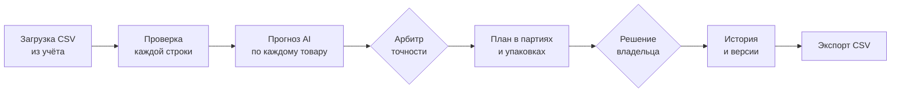
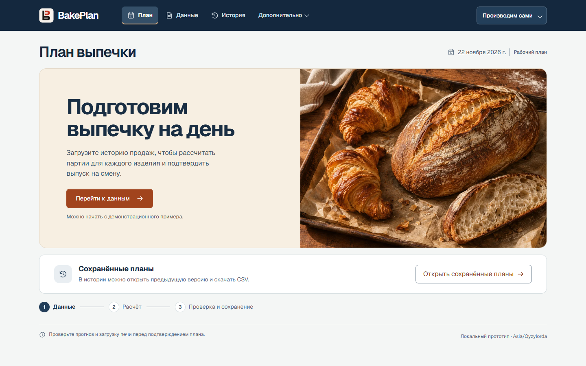
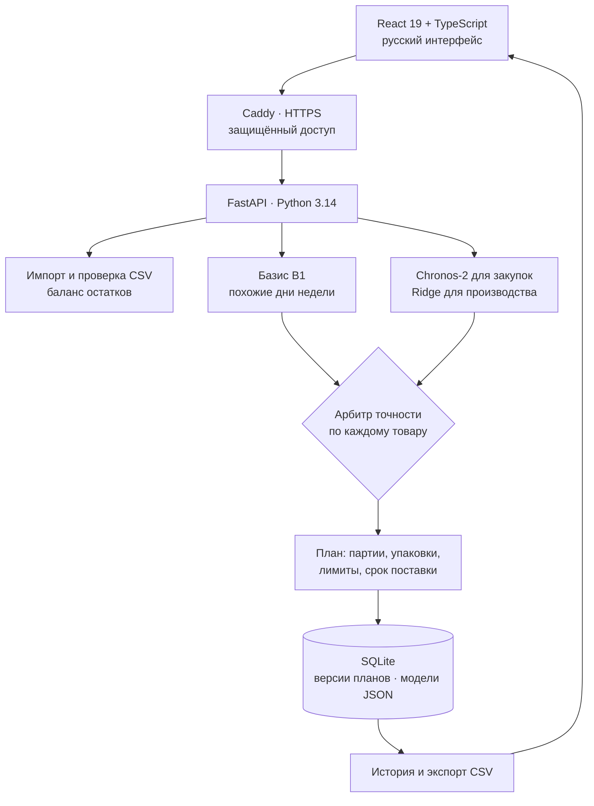

<p align="center">
  
</p>

<h1 align="center">BakePlan</h1>

> **In English.** BakePlan is AI demand forecasting and purchase planning for bakeries, cafés, clubs and mini-markets. It turns a CSV of sales history into tomorrow's production plan or supplier order. The manager of the Cloud Game Zone computer-club chain reports use at four branches. Purchase orders use offline Chronos-2 forecasts. A same-weekday baseline can replace Chronos for a sparse product when it wins on paired historical dates. Bakery production also supports the original Ridge model. Automated checks run on Windows and Linux. Digital Taraz top-10 finalist.
>
> **[Live demo](https://bakeplan.spotlightdesk.xyz/)** (data resets hourly) · **[Demo video](presentation/BakePlan_CGZ_demo.mp4)**\
> The interface and the rest of this README are in Russian: in the demo, open «Данные» and press «Загрузить демо CSV».

<p align="center"><b>AI-планирование выпуска и закупок для малого бизнеса — от истории продаж до утверждённого заказа</b></p>

<p align="center">
  <a href="https://bakeplan.spotlightdesk.xyz/">Открыть BakePlan</a> ·
  <a href="presentation/BakePlan_CGZ_demo.mp4">Смотреть видеодемонстрацию</a> ·
  <a href="presentation/">Презентация для жюри</a> ·
  <a href="#интерфейс">Интерфейс</a> ·
  <a href="#быстрый-старт">Быстрый старт</a> ·
  <a href="backend">Исходный код</a>
</p>

<p align="center">
  
  
  
  
  
  
  
  
</p>

<p align="center"><sub>Кейс хакатона <b>«AI for SME &amp; Local Business»</b> · Тараз и Жамбылская область</sub></p>

---

**BakePlan помогает малому бизнесу планировать выпуск и закупки на следующий день.** Первый клиент — сеть компьютерных клубов **Cloud Game Zone** (4 филиала, Шымкент). Следующий шаг — пекарни, кафе и клубы **Тараза и Жамбылской области**.

Пекарня получает план выпечки с учётом партий, лимитов и остатков, а клуб, кафе или мини-маркет — готовый заказ поставщику с учётом упаковок и срока поставки. По каждому товару видно три числа: прогноз продаж от AI, предложенное количество и решение владельца. Владелец подтверждает план одним действием, и он сразу сохраняется в истории и выгружается в CSV.

> **«До этого закупали администраторы как чувствуют»**
> — руководитель сети компьютерных клубов Cloud Game Zone

По словам руководителя, BakePlan используют **все 4 филиала сети**. Бар клуба каждый день заказывает воду, напитки и снеки, поэтому это идеальный полигон для AI-закупок.

## BakePlan в цифрах

| Цифра | Что за ней стоит |
|---|---|
| **1 заказ** | администратор проверяет готовые количества, подтверждает заказ и скачивает CSV |
| **2 режима** | один движок для двух типов бизнеса: выпуск (пекарня) и закупка (клуб, кафе, магазин) |
| **370+ автотестов** | серверная часть, оценка AI, интерфейс и сквозные браузерные сценарии |
| **2 ОС в CI** | каждое изменение проверяется на Windows и Linux, а CI сам проходит путь клиента и записывает его на видео |
| **67 коммитов за 6 дней** | 19 000+ строк кода на Python и TypeScript |
| **101 000+** | субъектов МСБ в Жамбылской области: каждая пекарня, кафе и клуб — потенциальный пользователь |

## Как это работает



1. **Загрузка.** Владелец загружает историю продаж из учёта. Каждая строка проверяется до сохранения.
2. **Прогноз.** AI считает продажи на целевой день отдельно по каждому товару.
3. **План.** Прогноз превращается в реальное количество: кратное партии печи или упаковке поставщика, в пределах лимитов, с учётом остатков и срока поставки.
4. **Решение.** Владелец видит основу расчёта, при необходимости правит количество и подтверждает.
5. **История.** Каждая версия плана сохраняется, к ней можно вернуться и выгрузить её в CSV.

## Интерфейс

<p align="center">
  
</p>

На стартовом экране выберите «Производим сами» или «Закупаем готовое». В «Данных» можно открыть собственный CSV или попробовать синтетический пример. После расчёта видны прогноз, рекомендация и количество, которое утвердит администратор. Для каждого товара количество к заказу учитывает размер упаковки поставщика. [Посмотреть заказ на шесть товаров](presentation/screenshots/purchase-order.webp)


---

## 1. Соответствие и глубина решения кейса

Кейс «AI for SME & Local Business» — про деньги и операции малого бизнеса. BakePlan бьёт ровно в ежедневное решение, которое принимают в каждой пекарне, кафе, баре и мини-маркете: **сколько испечь и сколько заказать**.

**Цена ошибки — в обе стороны:**

| Заказали больше | Заказали меньше | Считали вручную |
|---|---|---|
| Деньги заморожены в остатках, растут списания и просрочка | Пустая полка в пиковый вечер: клиент ушёл, маржа потеряна | Время администратора уходит на расчёт, а опыт живёт в голове одного человека |

**BakePlan учитывает реальные ограничения бизнеса, а не только «среднее по продажам»:**

- **Режим выпуска (пекарня):** выпуск кратен партии печи, есть дневной лимит выпуска, остатки переносятся на завтра, а баланс остатков сверяется в каждой строке.
- **Режим закупки (клуб, кафе, магазин):** учтены упаковки поставщика, максимальный заказ, срок поставки и пригодный остаток на день продажи.
- **Реалистичный контракт данных:** план делается сегодня на завтра по фактам до вчера включительно, ровно так, как работает настоящая точка.
- **Календарь точки:** закрытые дни, дни с дефицитом товара и часовой пояс Казахстана (Asia/Qyzylorda) учитываются явно.
- **Порог входа — один CSV-файл и обычный ноутбук.** Без GPU, облака и долгого внедрения.

## 2. Использование AI/IT-технологий

### Прогноз закупки

BakePlan оценивает ожидаемое количество продаж по квантилям предобученной Chronos-2. Расчёт выполняется на CPU. Для филиала используются только дни продаж и сведения о погоде и календаре, известные к дате расчёта. Дни без наблюдения остаются пропусками.

Для товара, у которого за последние 56 календарных дней более половины наблюдений составляют нулевые продажи, BakePlan проверяет также B1 — среднее по четырём доступным таким же дням недели за восемь недель. Сравниваются ошибки обоих методов на последних 7–14 доступных парных датах за 28 дней, с тем же горизонтом прогноза. B1 используется при строго меньшей средней абсолютной ошибке. При равенстве или нехватке проверочных дат используется Chronos-2. Для товара без истории количество требует решения администратора.

Администратор получает один заказ. Правила упаковки, срока поставки, остатка, ожидаемых поставок и ручных корректировок применяются к выбранному прогнозу. В режиме производства доступна исходная модель Ridge для планирования выпечки.

### Проверка прогноза на открытых данных

В проверке прежней версии BakePlan с Ridge на 534 прогнозах для французской пекарни средняя абсолютная ошибка BakePlan составила 24,83 изделия, у среднего по четырём предыдущим таким же дням недели — 36,37. При сравнении с продажами ровно неделю назад преимущество сократилось до 4,2% на 522 сопоставимых прогнозах. В трёх точках общепита ошибка прогноза числа чеков с конкретным напитком снизилась на 7,0% относительно среднего по дням недели. В тестах на вендинге и покупках участников розничной панели базовый прогноз оказался чуть точнее. Проверялся прогноз зарегистрированных продаж или покупок. Экономический эффект в Cloud Game Zone требует замеров в самих филиалах. [Данные, прогнозы по датам и команды повторного запуска](benchmarks/open-sales/README.md)

### Архитектура

[Схемы C4](docs/architecture/diagrams.md) показывают, где исполняются прогноз и ежедневное обновление. [Карта смены](docs/architecture/daily-order.md) связывает продажи, подтверждение заказа и приёмку поставки.



**Стек:** Python 3.14 · FastAPI · Pydantic · Chronos-2 · PyTorch · NumPy · React 19 · TypeScript · Vite · SQLite · Docker · Caddy (HTTPS) · GitHub Actions · Playwright.

## 3. Креативность и инновационность

- **Проверка на редких продажах.** Повторяющиеся нулевые дни запускают сравнение Chronos-2 и B1 на истории конкретного товара. Основа расчёта сохраняется в заказе.
- **Один движок — два бизнеса.** Производство с партиями печи и закупка с упаковками поставщика работают на одной платформе. Подходит пекарням, кафе, кофейням, барам и мини-маркетам — везде, где товар заказывают на завтра.
- **Человек в центре решения.** AI предлагает, владелец решает. Прогноз, предложение и подтверждённое количество показаны отдельно, а каждая правка становится новой версией в истории.
- **Опыт перестаёт жить в голове одного человека** и переходит в данные и модель.

**Чем BakePlan лучше тетради и Excel:**

| Задача | Тетрадь / Excel | BakePlan |
|---|---|---|
| Прогноз по каждому товару | Вручную, на глаз | AI + базис, автоматически |
| Упаковки и лимиты | Держать в голове | Учтены в каждом заказе |
| Проверка точности | Нет | AI сверяется с историей |
| История решений | Теряется | Каждая версия сохранена |
| Где живёт опыт | В голове одного человека | В данных и модели |

## 4. Реализация MVP

**Полный цикл работает от начала до конца:** импорт CSV → проверка → обучение AI → прогноз → план → ручная правка → подтверждение → история → экспорт CSV. Данные переживают перезапуск сервера.

**Надёжность продакшн-уровня:**

- ✅ Файл проверяется целиком, без частичной записи: ошибка в одной строке отклоняет весь импорт.
- ✅ Баланс остатков сверяется в каждой строке: `начало + поступление = продажи + списание + конец`.
- ✅ Миграции базы с автоматической резервной копией.
- ✅ Консистентный бэкап и восстановление SQLite с SHA-256 манифестом и проверкой целостности.
- ✅ Повторная отправка запроса не создаёт дубликатов (ключи идемпотентности для импорта, обучения и подтверждения).
- ✅ Адаптивный русский интерфейс от телефона до ноутбука (360 / 768 / 1440 px), клавиатурная навигация и доступные формы.
- ✅ Готово к развёртыванию: Docker, HTTPS-шлюз Caddy, защищённый доступ, защита от CSRF, контейнеры без root-прав и read-only файловая система, API закрыт во внутренней сети.

**MVP работает — и это проверено:**

| Набор | Тестов |
|---|---|
| Серверные тесты (pytest) | 248 |
| Оценка AI (offline) | 49 |
| Интерфейс (Vitest) | 41+ |
| Сквозные браузерные сценарии (Playwright), включая перезапуск API | 35 |
| **Итого** | **370+** |

CI на **Windows и Linux** проверяет каждое изменение, проходит путь клиента от CSV до экспорта заказа, снимает скриншоты интерфейса и **записывает демонстрацию на видео**. На Linux дополнительно собирается и проверяется изолированное Docker-демо с бэкапом и восстановлением базы.

## Экономика: где BakePlan даёт деньги

| Рычаг 1 · Замороженный капитал | Рычаг 2 · Возвращённая маржа | Рычаг 3 · Время администратора |
|---|---|---|
| `средний остаток × закупочная цена` | `доп. продажи × (цена − себестоимость)` | `заказы × (минуты до − минуты после)` |
| Меньше лишнего товара — больше свободных денег в обороте | Товар есть на полке в пиковые часы — клиент не уходит | Считает система, человек только проверяет и подтверждает |

При допущении «15 минут ежедневно в каждом из четырёх филиалов» за 30 дней на заказы уходит **30 часов**. Экономию времени предстоит измерить на сопоставимых заказах. Полевые замеры, списания и оплату подписки будем проверять отдельно. [План и критерии успеха пилота](PRODUCT_PLAN.md)

## Дорожная карта: Шымкент → Тараз → вся область

| Сейчас | Шаг 2 · 2 недели | Шаг 3 | Шаг 4 |
|---|---|---|---|
| **MVP и первый клиентский контакт.** По словам руководителя, продукт используют в четырёх филиалах Cloud Game Zone | **Пилот с замерами.** Остатки, дефицит и время администратора — до и после | **Тараз.** Пекарни, кафе и клубы Тараза и Жамбылской области | **Масштаб.** Интеграция с кассами, уведомления в Telegram, облако для сетей |

**Цель — AI-помощник по закупкам в каждой малой точке региона.**

## Быстрый старт

Нужны Git, Python 3.14 и Node.js 24. Windows PowerShell:

```powershell
git clone https://github.com/Nurlan-byte/byte.git bakeplan
cd bakeplan
python -m venv .venv
.\.venv\Scripts\python.exe -m pip install -r backend/requirements.lock
.\.venv\Scripts\python.exe -m backend.chronos_assets
npm.cmd --prefix frontend ci

# Терминал 1 — API
$env:BAKEPLAN_DB = "data/bakeplan.sqlite3"
# Для локальной демонстрации на личном ПК с пустым реестром администраторов
$env:BAKEPLAN_LOCAL_DEMO = "1"
# Для личного рабочего места с импортом из кассы:
$env:BAKEPLAN_POS_ENABLED = "1"
.\.venv\Scripts\python.exe -m uvicorn backend.app:app --host 127.0.0.1 --port 8000

# Терминал 2 — интерфейс
npm.cmd --prefix frontend run dev
```

Команда `backend.chronos_assets` один раз загружает закреплённые веса (478 МБ) и проверяет SHA-256. Docker выполняет этот шаг при сборке. Для уже подготовленной папки модели задайте `BAKEPLAN_CHRONOS_MODEL_PATH` на сервере. Прогноз выполняется локально и не требует ключа облачной модели. [Модель Amazon Chronos-2 и лицензия Apache 2.0](https://huggingface.co/amazon/chronos-2)

Откройте http://127.0.0.1:5173, в разделе **Данные** нажмите «Загрузить демо CSV» — и через пару кликов готов первый план.

Демо-сценарий бара Cloud Game Zone построен на смоделированных данных: коммерческие данные клиента остаются у клиента.

### Доступ администраторов по филиалам

Владелец сервера назначает каждому логину один филиал. Несколько администраторов могут работать с одним филиалом. При входе BakePlan автоматически открывает его заказы. Права действуют и для прямых ссылок, истории правок, выгрузок CSV, отчётов и подключений кассы.

Для CSV используйте точное значение `bakery_id` из истории филиала. Для кассы командой `python -m scripts.pos_branches poster` или `python -m scripts.pos_branches moysklad` можно получить идентификатор точки у поставщика. Ключ вводится в скрытом приглашении.

На машине с рабочей базой укажите её путь в `BAKEPLAN_DB`. Для уже настроенного входа через Caddy возьмите хэш того же логина из файла пользователей шлюза. Например, для логина `admin-north` и филиала `north`:

```sh
python -m backend.branch_accounts assign admin-north north --caddy-users /private/demo_users
```

В Docker файл пользователей смонтирован только в шлюз. Команду можно выполнить с хоста в каталоге проекта, передав файл через стандартный ввод:

```sh
docker compose -f deploy/compose.yaml exec -T api python -m backend.branch_accounts assign admin-north north --caddy-users - < "$BAKEPLAN_AUTH_FILE"
```

Для отдельного локального API запустите `python -m backend.branch_accounts assign admin-north north` и введите пароль в терминале. Повторное назначение меняет филиал. Команда `python -m backend.branch_accounts revoke admin-north` отзывает доступ со следующего запроса. После смены пароля в Caddy повторите назначение с обновлённым файлом. Перед открытием восстановленной базы сверьте назначения и отзывы доступа, поскольку резервная копия содержит реестр и хэши на дату копирования.

Старые заказы с однозначной привязкой к набору данных автоматически доступны своему филиалу. Записи с отсутствующим или противоречивым владельцем сохраняются в базе и скрыты до сверки владельцем сервера. Локальное демо без входа включается только явно, на личном компьютере, при пустом реестре. Для общей установки используйте отдельные логины и HTTPS.

В режиме закупок откройте **Реестр поставок** выбранного филиала. Введите номер накладной, товар, ожидаемую дату и количество. При разгрузке укажите, сколько единиц фактически приняли. Если из 12 бутылок приняли 5, в пути останутся 7. Остаток партии можно принять позже, перенести на другую дату или отменить.

При рабочем расчёте BakePlan берёт из реестра неполученное количество с ожидаемой датой от дня заказа до дня продаж включительно. Уже принятые товары учитывайте в доступном остатке к открытию. Если поставщик опаздывает, обновите ожидаемую дату. Для исторического сценария укажите поставки вручную. В сохранённом заказе и его CSV можно проверить, какие партии и в каком количестве участвовали в расчёте.

Кнопка **Требуют проверки** показывает проблемные позиции и причину. После подтверждения кнопка **Скопировать заказ** готовит текст для поставщика, а CSV сохраняет номер и версию заказа.

Предложения по дальнейшему развитию и критерии проверки собраны в [заметке об архитектуре](ARCHITECTURE.md).

### Первый прогноз из кассы

В разделе **Данные → Подключить кассу по ключу API** выберите Poster POS или МойСклад. Вставьте ключ с правом чтения точек и продаж или откройте файл `.txt`. На рабочем месте с настроенным хранилищем включено ежедневное обновление. Для одной точки BakePlan продолжит сразу, для нескольких предложит выбрать филиал. Исходный период — 56 завершённых дней, его можно изменить до 120. [Документация Poster](https://github.com/joinposter/docs/blob/master/ru/web/transactions/getTransactions.md) · [Документация МойСклад](https://dev.moysklad.ru/doc/api/remap/1.2/)

Для первого прогноза достаточно продаж. Если касса подтвердила единицы товара, прогноз показан в штуках. Чтобы перейти к заказу, откройте **Подготовить заказ поставщику**, укажите количество в упаковке и проверьте срок поставки и доступный остаток. Если единицы смешаны или неизвестны, BakePlan показывает частоту появления товара в чеках. Возвраты и наличие на полке в этот показатель не входят. Для iikoCloud пока используйте импорт CSV. Прямое подключение её отчётов требует регистрации приложения BakePlan, идентификатора, секрета приложения и ключа организации. [Порядок доступа к отчётам iiko](https://api.iiko.help/docs/en/guides/analytics-and-reports/)

**Календарь и погода.** По умолчанию используется производственный календарь Казахстана за 2025–2026 годы. Вне этого периода или при выборе другой страны доступны дни недели. Если адрес филиала позволяет определить один из восьми поддерживаемых городов, BakePlan может добавить погоду автоматически. Город можно выбрать вручную, а календарь и погоду можно добавить и к ранее загруженному CSV. Прогноз закупки использует доступные выходные, праздники, температуру, её изменение и осадки. В расчёт допускаются только сведения, доступные к его дате. При недоступности погоды расчёт продолжается. [Официальный календарь Казахстана](https://www.gov.kz/article/33969?lang=ru) · [Методика и результаты на открытых данных](benchmarks/context/README.md)

**Размещение.** Для одного администратора достаточно запущенного приложения на обычном компьютере. Интернет нужен для загрузки кассы и обновления погоды. Для нескольких филиалов используйте одно постоянно доступное рабочее место или сервер с HTTPS, входом для операторов и резервной копией SQLite. Обучение работает на CPU. Для коммерческого доступа к архиву прогнозов настройте на сервере `BAKEPLAN_WEATHER_API_KEY` с подходящей подпиской Open-Meteo. Для некоммерческого теста установите `BAKEPLAN_WEATHER_MODE=evaluation`. Для календаря подписка не требуется. При запуске приватного рабочего пространства в Docker добавьте к основной конфигурации файл `deploy/compose.pos.yaml`, чтобы разрешить исходящие соединения. [Условия Open-Meteo](https://open-meteo.com/en/pricing) · [Архив прогнозов](https://open-meteo.com/en/docs/previous-runs-api) · [Настройка приватного запуска](deploy/.env.example)

### Как проверить результат по филиалу

В **Данных** у сохранённого подключения указана последняя подтверждённая дата продаж. В **Истории → Правки заказов и точность прогноза** можно выбрать период и увидеть, сколько рекомендаций администратор изменил хотя бы на упаковку. Для сверки отчёт берёт продажи в штуках из выбранного в рабочем пространстве набора того же филиала. Он показывает число сопоставленных товаро-дней, среднюю абсолютную ошибку и на сколько штук прогноз в среднем завышал или занижал продажи. [Правила расчёта](docs/decisions/0001-order-quality.md) · [Подключение мониторинга и MLflow](tools/README.md#контроль-ежедневного-заказа)

В **Истории → Прогнозы и фактические продажи** администратор видит ошибки автоматического прогноза и B1 на одних товарах и датах, в том числе когда заказ не подтвердили. Выберите период продаж и срок прогноза. Сверка начинается с первого прогноза, записанного после обновления приложения. По завершении дня импортируйте продажи или дождитесь ежедневной синхронизации кассы. Отчёт показывает, сколько товаро-дней удалось сверить и сколько осталось без факта, пришлось на закрытие или отсутствие товара. Штуки и строки чеков оцениваются отдельно.

### Ежедневное обновление продаж и прогноза

Владелец сервера один раз создаёт ключ шифрования. На Windows выполните следующие команды из каталога проекта после установки зависимостей. Команда создаёт новый файл с закрытыми правами и отказывается перезаписывать существующий ключ.

```powershell
$posSecretDir = Join-Path $env:LOCALAPPDATA "BakePlan/secrets"
New-Item -ItemType Directory -Path $posSecretDir -Force | Out-Null
$posMasterPath = Join-Path $posSecretDir "pos-master.key"
.\.venv\Scripts\python.exe -m backend.pos_vault init $posMasterPath
```

При каждом запуске сервера укажите путь к тому же файлу. Эти настройки можно сохранить в окружении службы. В кабинете администратор вводит только ключ кассы.

```powershell
$env:BAKEPLAN_POS_ENABLED = "1"
$env:BAKEPLAN_POS_MASTER_KEY_FILE = Join-Path $env:LOCALAPPDATA "BakePlan/secrets/pos-master.key"
.\.venv\Scripts\python.exe -m uvicorn backend.app:app --host 127.0.0.1 --port 8000
```

После подключения BakePlan сразу пытается получить продажи и рассчитать прогноз. Затем работающий сервер каждый день после **05:00 по времени Казахстана (UTC+5)** загружает завершённые дни и сохраняет прогноз на завтра. Браузер можно закрыть. Если сервер был выключен, он проверит пропущенное обновление после запуска. При ошибке кассы предыдущий успешный прогноз остаётся доступным. В «Данных» можно посмотреть дату обновления и отключить филиал. Отключение удаляет сохранённый ключ этого подключения. Уже загруженные продажи и подтверждённые заказы остаются в истории.

Для Linux с Docker подключите `deploy/compose.yaml`, `deploy/compose.pos.yaml` и `deploy/compose.pos-daily.yaml` в указанном порядке. В файле окружения укажите абсолютный путь хоста `BAKEPLAN_POS_MASTER_KEY_FILE`. Для создания файла используйте ту же команду `python -m backend.pos_vault init`. Дайте владельцу файла UID 10001 (пользователь API в контейнере), права 0600 и подключайте файл как секрет. Шлюз получает только данные для входа операторов. [Конфигурация ежедневного подключения](deploy/compose.pos-daily.yaml) · [Секреты в Docker Compose](https://docs.docker.com/compose/how-tos/use-secrets/)

Сохраните резервную копию ключа шифрования отдельно от SQLite и её копий. При восстановлении базы потребуется исходный файл ключа. Если доступ к токену нужно отозвать полностью, отзовите его в кассовой системе, включая случай, когда токен остался зашифрованным в старой резервной копии.

## Команда

- **Нурлан** — продукт, AI, код
- **Асылжан** — клиенты, данные, презентация

Как устроена работа команды: [CONTRIBUTING](CONTRIBUTING.md).

<p align="center"><br><b>BakePlan — меньше интуиции, больше выручки.</b><br><sub>Ищем пекарни, кафе и клубы Тараза для пилота.</sub></p>
