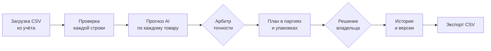
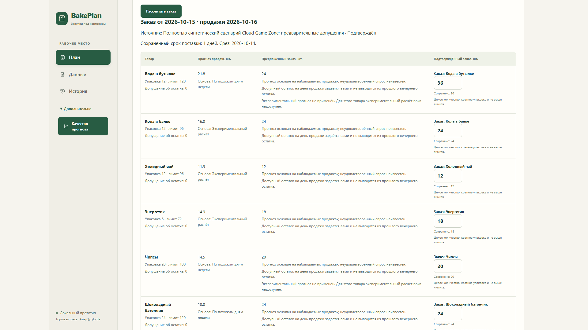
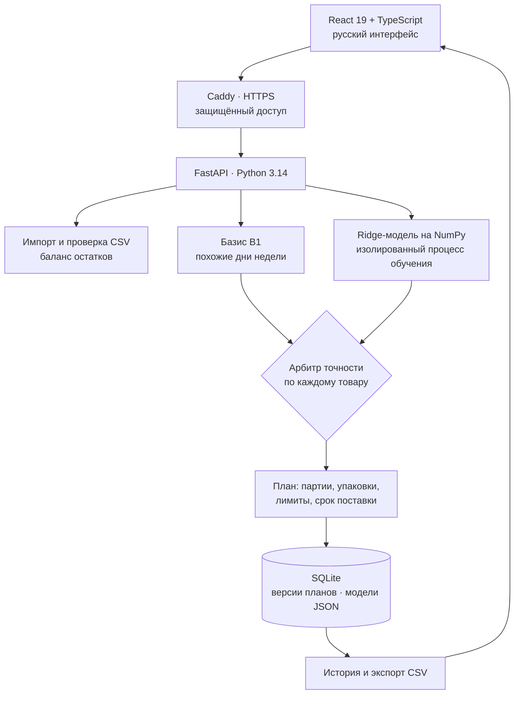

<p align="center">
  
</p>

<h1 align="center">BakePlan</h1>

<p align="center"><b>AI-планирование выпуска и закупок для малого бизнеса — от истории продаж до утверждённого заказа</b></p>

<p align="center">
  <a href="https://sorted-carries-seems-maker.trycloudflare.com/">Открыть BakePlan</a> ·
  <a href="presentation/BakePlan_CGZ_demo.mp4">Смотреть видеодемонстрацию</a> ·
  <a href="presentation/BakePlan_pitch.pdf">Презентация для жюри</a> ·
  <a href="#интерфейс">Интерфейс</a> ·
  <a href="#быстрый-старт">Быстрый старт</a> ·
  <a href="backend">Исходный код</a>
</p>

<p align="center">
  
  
  
  
  
  
  
  
</p>

<p align="center"><sub>Кейс хакатона <b>«AI for SME &amp; Local Business»</b> · Тараз и Жамбылская область</sub></p>

---

**BakePlan помогает малому бизнесу планировать выпуск и закупки на следующий день.** Первый клиент — сеть компьютерных клубов **Cloud Game Zone** (4 филиала, Шымкент). Следующий шаг — пекарни, кафе и клубы **Тараза и Жамбылской области**.

Пекарня получает план выпечки с учётом партий, лимитов и остатков, а клуб, кафе или мини-маркет — готовый заказ поставщику с учётом упаковок и срока поставки. По каждому товару видно три числа: прогноз продаж от AI, предложенное количество и решение владельца. Владелец подтверждает план одним действием, и он сразу сохраняется в истории и выгружается в CSV.

> **«До этого закупали администраторы как чувствуют»**
> — руководитель сети компьютерных клубов Cloud Game Zone

По словам руководителя, BakePlan используют **все 4 филиала сети**. Бар клуба каждый день заказывает воду, напитки и снеки, поэтому это идеальный полигон для AI-закупок.

## BakePlan в цифрах

| Цифра | Что за ней стоит |
|---|---|
| **≈ 3 секунды** | полный цикл на обычном ноутбуке без GPU: импорт 546 строк → обучение AI → прогноз → заказ → история |
| **2 режима** | один движок для двух типов бизнеса: выпуск (пекарня) и закупка (клуб, кафе, магазин) |
| **3 из 6** | товаров демо-заказа получили AI-прогноз, а для остальных арбитр сам выбрал базис |
| **370+ автотестов** | серверная часть, оценка AI, интерфейс и сквозные браузерные сценарии |
| **2 ОС в CI** | каждое изменение проверяется на Windows и Linux, а CI сам проходит путь клиента и записывает его на видео |
| **67 коммитов за 6 дней** | 19 000+ строк кода на Python и TypeScript |
| **101 000+** | субъектов МСБ в Жамбылской области: каждая пекарня, кафе и клуб — потенциальный пользователь |

## Как это работает



1. **Загрузка.** Владелец загружает историю продаж из учёта. Каждая строка проверяется до сохранения.
2. **Прогноз.** AI считает продажи на целевой день отдельно по каждому товару.
3. **План.** Прогноз превращается в реальное количество: кратное партии печи или упаковке поставщика, в пределах лимитов, с учётом остатков и срока поставки.
4. **Решение.** Владелец видит основу расчёта, при необходимости правит количество и подтверждает.
5. **История.** Каждая версия плана сохраняется, к ней можно вернуться и выгрузить её в CSV.

## Интерфейс

<p align="center">
  
</p>

<p align="center"><sub>Заказ бара на пятницу на одном экране. Прогноз воды 21,8 → предложение 24 (две упаковки по 12) → владелец ставит 36 и подтверждает.</sub></p>

---

## 1. Соответствие и глубина решения кейса

Кейс «AI for SME & Local Business» — про деньги и операции малого бизнеса. BakePlan бьёт ровно в ежедневное решение, которое принимают в каждой пекарне, кафе, баре и мини-маркете: **сколько испечь и сколько заказать**.

**Цена ошибки — в обе стороны:**

| Заказали больше | Заказали меньше | Считали вручную |
|---|---|---|
| Деньги заморожены в остатках, растут списания и просрочка | Пустая полка в пиковый вечер: клиент ушёл, маржа потеряна | Время администратора уходит на расчёт, а опыт живёт в голове одного человека |

**BakePlan учитывает реальные ограничения бизнеса, а не только «среднее по продажам»:**

- **Режим выпуска (пекарня):** выпуск кратен партии печи, есть дневной лимит выпуска, остатки переносятся на завтра, а баланс остатков сверяется в каждой строке.
- **Режим закупки (клуб, кафе, магазин):** учтены упаковки поставщика, максимальный заказ, срок поставки и пригодный остаток на день продажи.
- **Реалистичный контракт данных:** план делается сегодня на завтра по фактам до вчера включительно, ровно так, как работает настоящая точка.
- **Календарь точки:** закрытые дни, дни с дефицитом товара и часовой пояс Казахстана (Asia/Qyzylorda) учитываются явно.
- **Порог входа — один CSV-файл и обычный ноутбук.** Без GPU, облака и долгого внедрения.

## 2. Использование AI/IT-технологий

### Гибридный AI: базис, модель, арбитр

| 01 · Базис | 02 · Модель | 03 · Арбитр |
|---|---|---|
| **Похожие дни (B1).** Среднее продаж за последние 4 таких же дня недели. Надёжная опора уже с первых недель работы | **Ridge-регрессия.** Одна модель на все товары учится на отклонениях от базиса: продажи 2, 7, 14 и 28 дней назад, средние за 7 и 28 дней, день недели | **Контроль точности.** Для каждого товара сравнивает ошибку AI и базиса на прошлых датах. AI включается только там, где он точнее |

**Почему прогнозу можно доверять:**

- **Без заглядывания в будущее.** Модель видит только данные до даты среза, а обучающий срез и проверка используют тот же двухдневный горизонт, что и реальная работа.
- **Встроенные ограничители.** AI сдвигает базис только в разумных пределах, от −80% до +200%. Модель старше 14 дней помечается.
- **Объяснимость.** Рядом с каждым товаром видна основа расчёта: AI или похожие дни недели.
- **Честный fallback.** Если истории мало, система переходит на базис или ручной ввод и объясняет почему, а не подставляет «ноль».
- **Безопасное хранение моделей.** Модели сохраняются как JSON с привязкой к набору данных, хешу снимка и версии протокола, без pickle и исполняемого кода.
- **Изолированное обучение.** Модель обучается в отдельном процессе с лимитами по времени (60 с) и объёму данных, так что сервер не зависает.
- **Своя реализация Ridge на NumPy.** Решение в замкнутой форме, без тяжёлых ML-фреймворков, поэтому быстро обучается и работает на любом ноутбуке.

### Архитектура



**Стек:** Python 3.14 · FastAPI · Pydantic · NumPy · React 19 · TypeScript · Vite · SQLite · Docker · Caddy (HTTPS) · GitHub Actions · Playwright.

## 3. Креативность и инновационность

- **AI с самоконтролем.** Встроенный арбитр решает отдельно для каждого товара, где AI точнее базиса. В демо-заказе AI получили кола, холодный чай и энергетик, а вода, чипсы и шоколадный батончик остались на базисе. Никакого AI «для галочки»: каждое включение подтверждено проверкой на истории конкретного товара.
- **Один движок — два бизнеса.** Производство с партиями печи и закупка с упаковками поставщика работают на одной платформе. Подходит пекарням, кафе, кофейням, барам и мини-маркетам — везде, где товар заказывают на завтра.
- **Человек в центре решения.** AI предлагает, владелец решает. Прогноз, предложение и подтверждённое количество показаны отдельно, а каждая правка становится новой версией в истории.
- **Опыт перестаёт жить в голове одного человека** и переходит в данные и модель.

**Чем BakePlan лучше тетради и Excel:**

| Задача | Тетрадь / Excel | BakePlan |
|---|---|---|
| Прогноз по каждому товару | Вручную, на глаз | AI + базис, автоматически |
| Упаковки и лимиты | Держать в голове | Учтены в каждом заказе |
| Проверка точности | Нет | AI сверяется с историей |
| История решений | Теряется | Каждая версия сохранена |
| Где живёт опыт | В голове одного человека | В данных и модели |

## 4. Реализация MVP

**Полный цикл работает от начала до конца:** импорт CSV → проверка → обучение AI → прогноз → план → ручная правка → подтверждение → история → экспорт CSV. Данные переживают перезапуск сервера.

**Надёжность продакшн-уровня:**

- ✅ Файл проверяется целиком, без частичной записи: ошибка в одной строке отклоняет весь импорт.
- ✅ Баланс остатков сверяется в каждой строке: `начало + поступление = продажи + списание + конец`.
- ✅ Миграции базы с автоматической резервной копией.
- ✅ Консистентный бэкап и восстановление SQLite с SHA-256 манифестом и проверкой целостности.
- ✅ Повторная отправка запроса не создаёт дубликатов (ключи идемпотентности для импорта, обучения и подтверждения).
- ✅ Адаптивный русский интерфейс от телефона до ноутбука (360 / 768 / 1440 px), клавиатурная навигация и доступные формы.
- ✅ Готово к развёртыванию: Docker, HTTPS-шлюз Caddy, защищённый доступ, защита от CSRF, контейнеры без root-прав и read-only файловая система, API закрыт во внутренней сети.

**MVP работает — и это проверено:**

| Набор | Тестов |
|---|---|
| Серверные тесты (pytest) | 248 |
| Оценка AI (offline) | 49 |
| Интерфейс (Vitest) | 41+ |
| Сквозные браузерные сценарии (Playwright), включая перезапуск API | 35 |
| **Итого** | **370+** |

CI на **Windows и Linux** проверяет каждое изменение, проходит путь клиента от CSV до экспорта заказа, снимает скриншоты интерфейса и **записывает демонстрацию на видео**. На Linux дополнительно собирается и проверяется изолированное Docker-демо с бэкапом и восстановлением базы.

## Экономика: где BakePlan даёт деньги

| Рычаг 1 · Замороженный капитал | Рычаг 2 · Возвращённая маржа | Рычаг 3 · Время администратора |
|---|---|---|
| `средний остаток × закупочная цена` | `доп. продажи × (цена − себестоимость)` | `заказы × (минуты до − минуты после)` |
| Меньше лишнего товара — больше свободных денег в обороте | Товар есть на полке в пиковые часы — клиент не уходит | Считает система, человек только проверяет и подтверждает |

**Пример:** если заказ занимает 15 минут в день, 4 филиала тратят на него **30 часов в месяц**. Двухнедельный пилот измерит все три рычага в тенге. Формулы и метрики: [ECONOMICS](docs/ECONOMICS.md).

## Дорожная карта: Шымкент → Тараз → вся область

| Сейчас | Шаг 2 · 2 недели | Шаг 3 | Шаг 4 |
|---|---|---|---|
| **MVP и первый клиент.** Работающий продукт, 4 филиала Cloud Game Zone | **Пилот с замерами.** Остатки, дефицит и время администратора — до и после | **Тараз.** Пекарни, кафе и клубы Тараза и Жамбылской области | **Масштаб.** Интеграция с кассами, уведомления в Telegram, облако для сетей |

**Цель — AI-помощник по закупкам в каждой малой точке региона.**

## Быстрый старт

Нужны Git, Python 3.14 и Node.js 24. Windows PowerShell:

```powershell
git clone https://github.com/Nurlan-byte/byte.git bakeplan
cd bakeplan
python -m venv .venv
.\.venv\Scripts\python.exe -m pip install -r backend/requirements.lock
npm.cmd --prefix frontend ci

# Терминал 1 — API
$env:BAKEPLAN_DB = "data/bakeplan.sqlite3"
.\.venv\Scripts\python.exe -m uvicorn backend.app:app --host 127.0.0.1 --port 8000

# Терминал 2 — интерфейс
npm.cmd --prefix frontend run dev
```

Откройте http://127.0.0.1:5173, в разделе **Данные** нажмите «Загрузить демо CSV» — и через пару кликов готов первый план. Linux/macOS, Docker и HTTPS-размещение: [руководство разработчика](docs/DEVELOPMENT.md), [Windows + Docker](docs/LOCAL_WINDOWS.md), [развёртывание](docs/DEPLOYMENT.md).

Демо-сценарий бара Cloud Game Zone построен на смоделированных данных: коммерческие данные клиента остаются у клиента.

## Команда

- **Нурлан** — продукт, AI, код
- **Асылжан** — клиенты, данные, презентация

Как устроена работа команды: [CONTRIBUTING](CONTRIBUTING.md).

<p align="center"><br><b>BakePlan — меньше интуиции, больше выручки.</b><br><sub>Ищем пекарни, кафе и клубы Тараза для пилота.</sub></p>
