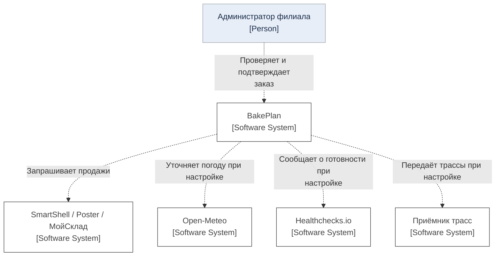
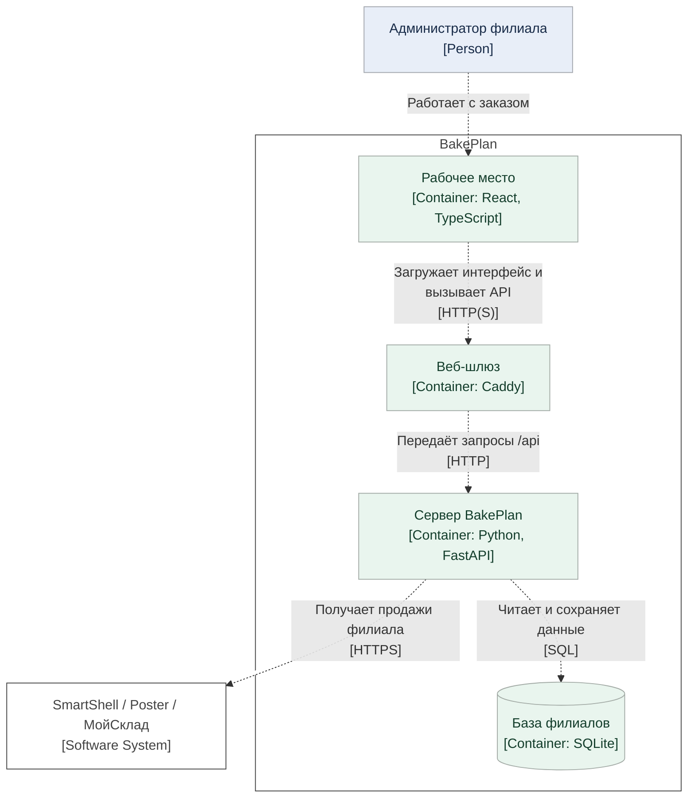

# Архитектура ежедневного заказа

Модель описывает приватную установку BakePlan. Кассу можно подключить для ежедневного импорта. Погода, внешний мониторинг и передача трасс включаются в настройках. При загрузке CSV администратору достаточно самого приложения.

Схемы получены из [модели C4](workspace.dsl). Нижняя схема прослеживает путь от кассы до рабочего места администратора. React работает в браузере, а планировщик и Chronos-2 работают внутри сервера API. SQLite хранит данные в файле на диске сервера.

## Окружение системы



## Контейнеры и потоки данных



## Обновление схем

Скачайте [Structurizr 2026.09.19](https://download.structurizr.com/structurizr-2026.09.19.war). Из корня репозитория запустите команду с установленными Java 21 или новее и Python 3.14. Она проверит контрольную сумму инструмента, разберёт модель и обновит эту страницу.

```shell
python docs/architecture/render.py path/to/structurizr-2026.09.19.war
```

Параметр `--check` сверяет страницу с текущей моделью. [Документация Structurizr](https://docs.structurizr.com/export)
